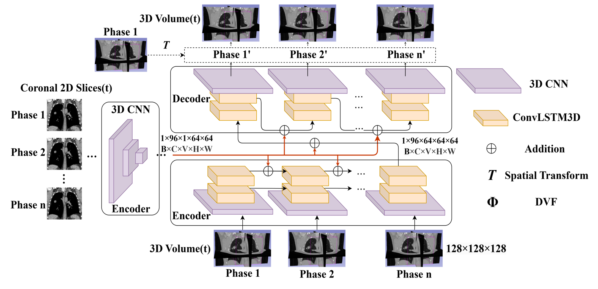

# DEMT-LI

Code for *DEMT-LI: A Deep Learning Framework for Dimensional Expansion Method for
Time-Series Lung Imaging* (manuscript under review).



DEMT-LI adds a sequential coronal 2D image-surrogate encoder to an RMSim-style
3D CNN–ConvLSTM3D deformation model. The network predicts dense displacement fields
(DVFs) that warp the 50% reference phase of a 4D-CT into the 50/70/90% phases. The
study is a retrospective, CT-only proof of concept on six POPI 4D-CT cases. It is not
validated for cine-MRI, clinical tumour localization or end-to-end MR-linac use.

## Protocol

* **Cross-validation.** Six outer patient-level folds with a 4–1–1 split. Fold *i*
  tests patient *i*, uses patient *i* mod 6 + 1 for internal validation and trains on
  the remaining four. All methods share the same splits. The internal-validation loss
  drives the learning-rate schedule and checkpoint selection. The test patient is
  loaded once, after the best checkpoint is fixed.
* **Loss.** Voxelwise MSE (HU) plus λ times the mean squared spatial DVF gradient,
  with λ = 1. Both terms are averaged over the three phases (`project/models/losses.py`).
* **Training** (`configs/config.yaml`). Adam with zero weight decay, 200 epochs,
  batch size 1, seed 42, FP32. ReduceLROnPlateau (factor 0.1, patience 10) monitors the
  internal-validation loss divided by its value before training. No dropout or early
  stopping.
* **Method-specific settings, kept from the original implementations:**

  | Method | Learning rate | Patient order |
  | --- | --- | --- |
  | `image_2d` (DEMT-LI) | 1e-3 | shuffled each epoch |
  | `rpm_1d` (1D diaphragm surrogate) | 1e-3 | shuffled each epoch |
  | `no_surrogate` | 1e-4 | fixed |

* **2D surrogate frames.** The surrogate encoder sees frames 50/70% in the encoder
  pass and 70/90% in the decoder pass (`project/models/Time_series_seq2seq_4DCT_voxelmorph.py`).
* **Statistics.** Phases are averaged within each patient before summarizing (n = 6).
  Paired comparisons use exact sign-flip tests, percentile patient-bootstrap 95% CIs
  (10,000 resamples, seed 20260817) and Holm correction within each family.

## Installation

```bash
python -m venv .venv && source .venv/bin/activate   # Python 3.10
pip install -r requirements.txt
python -m pytest -q test
```

The reported runs used an NVIDIA RTX 3090 (24 GB), PyTorch 2.12.0 and CUDA 13.0.
In `sequence` mode, one training job needs about 12 GB of GPU memory and roughly 1.6 h
for 200 epochs.

## Data

1. **POPI 4D-CT and landmarks.** These are public data from CREATIS
   (Vandemeulebroucke et al., ICCR 2007). Download them with:

   ```bash
   python -m project.dataloader.popi --output data/popi
   ```

2. **Surrogate inputs.**
   * `2DCT-<patient>/{50,70,90}.png`: one fixed coronal frame per phase and patient
     (the 2D surrogate).
   * A 6 × 10 CSV of diaphragm-apex positions: one row per patient, one column per
     phase from 0% to 90% (the 1D surrogate).

   These surrogate inputs are not distributed with this repository.

3. **Build the model inputs.**

   ```bash
   python -m project.dataloader.prepare_data --popi-root data/popi --png-root <png dir> \
       --rpm-csv <rpm csv> --output data/inputs
   ```

   CT preprocessing keeps DICOM slices 10–137 and crops 320 × 320 around the slice
   centre. It then resizes each slice to 128 × 128 (torchvision bilinear, antialiased)
   and keeps Hounsfield units, matching the original data loader. Rebuilding from the
   public POPI archives reproduces the volumes used in the paper to within 5e-4 HU
   (float32 rounding).

## Running the experiments

`project/script.sh` runs the whole pipeline. The individual steps are:

| Paper item | Command |
| --- | --- |
| Training, 3 methods × 6 folds, then Tables II–III | `python -m project.main --data data/inputs --output runs/main --gpus 0 1 2 3 [--ct-input sequence]` |
| One fold | `python -m project.train --method image_2d --fold 1 --data data/inputs --output runs/main [--ct-input sequence]` |
| Tables II–III, Fig. 10 (image fidelity and paired tests) | `python -m project.evaluation.summarize --run runs/main --data data/inputs` |
| Figs. 12–14 (Experiment 2, regional-input sensitivity) | `python -m project.evaluation.regional_input --run runs/main --data data/inputs --output results/regional_input` |
| Tables V–VI, Figs. 20–22 (DVF plausibility, landmark TRE, resolution) | `python -m project.evaluation.auxiliary --run runs/main --popi-root data/popi --dicom-cache data/inputs/dicom --output results/auxiliary` |
| Fig. 23 (octant MAE) | `python -m project.evaluation.octant_error --run runs/main --data data/inputs --output results/octant` |
| Table VII (model-only latency) | `python -m project.evaluation.latency --checkpoint runs/main/image_2d/fold_01/best.pt --data data/inputs --output results/latency.json` |

Each fold directory contains `config.json`, `epochs.jsonl`, `best.pt`, `last.pt`,
`selection.json` and `test_prediction.npz` (the prediction plus the DVF of the held-out
patient).

### Reported image-fidelity results (`--ct-input sequence`; patient-level mean ± SD, n = 6)

| Method | SSIM | PSNR (dB) | MAE (HU) |
| --- | --- | --- | --- |
| No surrogate | 0.8984 ± 0.0408 | 35.61 ± 2.07 | 32.13 ± 8.54 |
| 1D RPM surrogate | 0.8942 ± 0.0423 | 34.99 ± 2.07 | 34.94 ± 9.86 |
| DEMT-LI (2D image surrogate) | 0.9445 ± 0.0284 | 39.86 ± 2.16 | 21.14 ± 4.98 |

Reproducibility: loading the reported checkpoints with this code reproduces the saved
predictions and DVFs exactly. A 3-epoch retraining check against the reported run
matched the initial validation loss, patient order and learning rate exactly. Loss
values differed at about the 1e-5 relative level, the same size as the difference
between two repeated runs of this code. The cause is that some CUDA backward kernels
(`grid_sample`, trilinear upsampling) are not bitwise deterministic, so retrained
weights will not be bit-identical to the reported checkpoints.

## Repository layout

```
configs/config.yaml        training hyper-parameters and default ct_input
images/                    architecture figure
project/
  main.py                  all folds and methods (multi-GPU), then summary
  train.py                 one method on one fold
  script.sh                end-to-end pipeline
  dataloader/              POPI download, CT/PNG/RPM preprocessing, 4-1-1 folds
  models/                  original network files (unchanged), network.py, losses.py
  utils/                   metrics, paired statistics, config loading
  evaluation/              summary statistics and secondary analyses
test/                      unit tests (no data or GPU required)
```

The original network files in `project/models/` are unchanged. This keeps checkpoints
loadable with `strict=True`:

| Method | Model file |
| --- | --- |
| `image_2d` | `Time_series_seq2seq_4DCT_voxelmorph.py` |
| `rpm_1d` | `RPM_Time_series_seq2seq_4DCT_voxelmorph.py` |
| `no_surrogate` | `seq2seq_4DCT_voxelmorph.py` |

They share `ConvLSTMCell3d.py`, `layers.py` (VoxelMorph-style `SpatialTransformer`) and
`unet_utils.py`.

## Acknowledgements

The deformation backbone follows RMSim (D. Lee et al., *Phys. Med. Biol.* 68:045009,
2023). The spatial transformer follows VoxelMorph (G. Balakrishnan et al., *IEEE TMI*
38:1788–1800, 2019). The data come from the POPI-model (J. Vandemeulebroucke et al.,
ICCR 2007).

## License

The network code in `project/models/` (`ConvLSTMCell3d.py`, `layers.py`,
`unet_utils.py` and the three model files) is derived from
[SeqX2Y / RMSim](https://github.com/nadeemlab/SeqX2Y) (Nadeem Lab, Memorial Sloan
Kettering Cancer Center). SeqX2Y is distributed under the Apache 2.0 license with the
Commons Clause and is available for non-commercial academic purposes. This repository
is distributed under the same terms.
